<a href="https://alfredsn.com">
<picture>
  <source media="(prefers-color-scheme: dark)" srcset="https://raw.githubusercontent.com/alfredsn/alfredsn/main/assets/header-dark.svg">
  <source media="(prefers-color-scheme: light)" srcset="https://raw.githubusercontent.com/alfredsn/alfredsn/main/assets/header-light.svg">
  
</picture>
</a>

[alfredsn.com](https://alfredsn.com) · [LinkedIn](https://www.linkedin.com/in/alfredsn/) · [contact@alfredsn.com](mailto:contact@alfredsn.com)

I'm a software engineer based in Indonesia. I started out building Android apps and now work full-stack, from the UI down to the API and the database. More and more of my work is AI engineering: building product features on top of LLMs.

Currently building [alfredsn.com](https://alfredsn.com). Open to collaborating on open source.

**Frontend** &nbsp; TypeScript · React · Next.js · Tailwind 
**Backend** &nbsp; Node.js · Go · Python · PostgreSQL · MongoDB · GraphQL 
**Mobile** &nbsp; Kotlin · Android · React Native · Flutter · Java 
**AI** &nbsp; LangChain · LLM APIs 
**Tooling** &nbsp; Docker · AWS · GitHub Actions · Figma

### Ask my AI

Got a question about my work? An AI answers it in about a minute, using only [what I've written about myself](https://github.com/alfredsn/alfredsn/blob/main/data/about.md). Pick one or ask your own.

<a href="https://github.com/alfredsn/alfredsn/issues/new?title=ask%3A+What+is+Alfred+building%3F&body=Press+Create.+An+AI+that+only+knows+Alfred%27s+profile+answers+here+within+a+minute."><picture><source media="(prefers-color-scheme: dark)" srcset="https://raw.githubusercontent.com/alfredsn/alfredsn/main/assets/buttons/ask-building-dark.svg"><source media="(prefers-color-scheme: light)" srcset="https://raw.githubusercontent.com/alfredsn/alfredsn/main/assets/buttons/ask-building-light.svg"></picture></a>
<a href="https://github.com/alfredsn/alfredsn/issues/new?title=ask%3A+What%27s+his+stack%3F&body=Press+Create.+An+AI+that+only+knows+Alfred%27s+profile+answers+here+within+a+minute."><picture><source media="(prefers-color-scheme: dark)" srcset="https://raw.githubusercontent.com/alfredsn/alfredsn/main/assets/buttons/ask-stack-dark.svg"><source media="(prefers-color-scheme: light)" srcset="https://raw.githubusercontent.com/alfredsn/alfredsn/main/assets/buttons/ask-stack-light.svg"></picture></a>
<a href="https://github.com/alfredsn/alfredsn/issues/new?title=ask%3A+Is+he+open+to+work%3F&body=Press+Create.+An+AI+that+only+knows+Alfred%27s+profile+answers+here+within+a+minute."><picture><source media="(prefers-color-scheme: dark)" srcset="https://raw.githubusercontent.com/alfredsn/alfredsn/main/assets/buttons/ask-hire-dark.svg"><source media="(prefers-color-scheme: light)" srcset="https://raw.githubusercontent.com/alfredsn/alfredsn/main/assets/buttons/ask-hire-light.svg"></picture></a>
<a href="https://github.com/alfredsn/alfredsn/issues/new?template=ask.yml"><picture><source media="(prefers-color-scheme: dark)" srcset="https://raw.githubusercontent.com/alfredsn/alfredsn/main/assets/buttons/ask-own-dark.svg"><source media="(prefers-color-scheme: light)" srcset="https://raw.githubusercontent.com/alfredsn/alfredsn/main/assets/buttons/ask-own-light.svg"></picture></a>

<!-- coding:start -->
<!-- coding:end -->

### The past year

<picture>
  <source media="(prefers-color-scheme: dark)" srcset="https://raw.githubusercontent.com/alfredsn/alfredsn/main/assets/city-dark.svg">
  <source media="(prefers-color-scheme: light)" srcset="https://raw.githubusercontent.com/alfredsn/alfredsn/main/assets/city-light.svg">
  
</picture>

<picture>
  <source media="(prefers-color-scheme: dark)" srcset="https://raw.githubusercontent.com/alfredsn/alfredsn/main/dist/snake-dark.svg">
  <source media="(prefers-color-scheme: light)" srcset="https://raw.githubusercontent.com/alfredsn/alfredsn/main/dist/snake-light.svg">
  
</picture>

### Leave a mark

Paint a pixel on the shared canvas or sign the guestbook. Either way, your avatar joins the wall below.

<picture>
  <source media="(prefers-color-scheme: dark)" srcset="https://raw.githubusercontent.com/alfredsn/alfredsn/main/assets/canvas-dark.svg">
  <source media="(prefers-color-scheme: light)" srcset="https://raw.githubusercontent.com/alfredsn/alfredsn/main/assets/canvas-light.svg">
  
</picture>

<a href="https://github.com/alfredsn/alfredsn/issues/new?template=pixel.yml"><picture><source media="(prefers-color-scheme: dark)" srcset="https://raw.githubusercontent.com/alfredsn/alfredsn/main/assets/buttons/paint-dark.svg"><source media="(prefers-color-scheme: light)" srcset="https://raw.githubusercontent.com/alfredsn/alfredsn/main/assets/buttons/paint-light.svg"></picture></a>
<a href="https://github.com/alfredsn/alfredsn/issues/new?title=guestbook%3A+hello&body=Just+press+Create.+A+bot+adds+your+avatar+to+the+wall+on+my+profile%2C+then+closes+this+issue."><picture><source media="(prefers-color-scheme: dark)" srcset="https://raw.githubusercontent.com/alfredsn/alfredsn/main/assets/buttons/sign-dark.svg"><source media="(prefers-color-scheme: light)" srcset="https://raw.githubusercontent.com/alfredsn/alfredsn/main/assets/buttons/sign-light.svg"></picture></a>

<!-- guestbook:start -->
Nobody yet. You could be first.
<!-- guestbook:end -->
