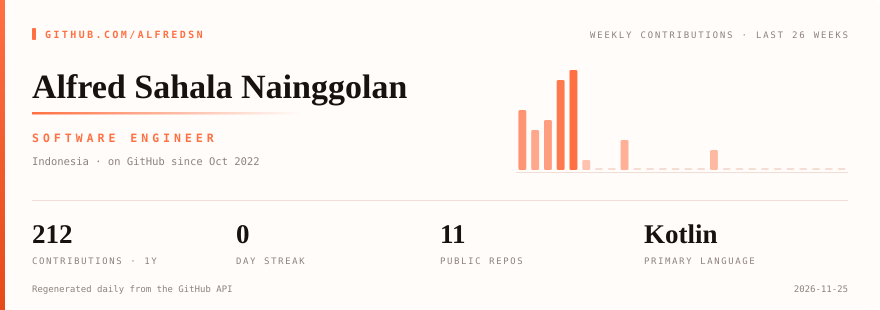

<a href="https://alfredsn.com">
  <picture>
    <source media="(prefers-color-scheme: dark)" srcset="https://raw.githubusercontent.com/alfredsn/alfredsn/main/assets/header-dark.svg">
    <source media="(prefers-color-scheme: light)" srcset="https://raw.githubusercontent.com/alfredsn/alfredsn/main/assets/header-light.svg">
    
  </picture>
</a>

[alfredsn.com](https://alfredsn.com) · [LinkedIn](https://www.linkedin.com/in/alfredsn/) · [contact@alfredsn.com](mailto:contact@alfredsn.com)

I'm a software engineer based in Indonesia. I started out building Android apps and now work full-stack, from the UI down to the API and the database. More and more of my work is AI engineering: building product features on top of LLMs.

Currently building [alfredsn.com](https://alfredsn.com). Open to collaborating on open source.

**Frontend** &nbsp; TypeScript · React · Next.js · Tailwind 
**Backend** &nbsp; Node.js · Go · Python · PostgreSQL · MongoDB · GraphQL 
**Mobile** &nbsp; Kotlin · Android · React Native · Flutter · Java 
**AI** &nbsp; LangChain · LLM APIs 
**Tooling** &nbsp; Docker · AWS · GitHub Actions · Figma

<picture>
  <source media="(prefers-color-scheme: dark)" srcset="https://raw.githubusercontent.com/alfredsn/alfredsn/main/assets/year-dark.svg">
  <source media="(prefers-color-scheme: light)" srcset="https://raw.githubusercontent.com/alfredsn/alfredsn/main/assets/year-light.svg">
  
</picture>

<picture>
  <source media="(prefers-color-scheme: dark)" srcset="https://raw.githubusercontent.com/alfredsn/alfredsn/main/dist/snake-dark.svg">
  <source media="(prefers-color-scheme: light)" srcset="https://raw.githubusercontent.com/alfredsn/alfredsn/main/dist/snake-light.svg">
  
</picture>

### Guestbook

Passing through? **[Sign the guestbook](https://github.com/alfredsn/alfredsn/issues/new?title=guestbook%3A+hello&body=Just+press+%22Create%22.+A+bot+adds+your+avatar+to+the+wall+on+my+profile%2C+then+closes+this+issue.)**. Press Create on the issue that opens, and a bot adds your avatar here within a minute.

<!-- guestbook:start -->
Nobody yet. You could be first.
<!-- guestbook:end -->
